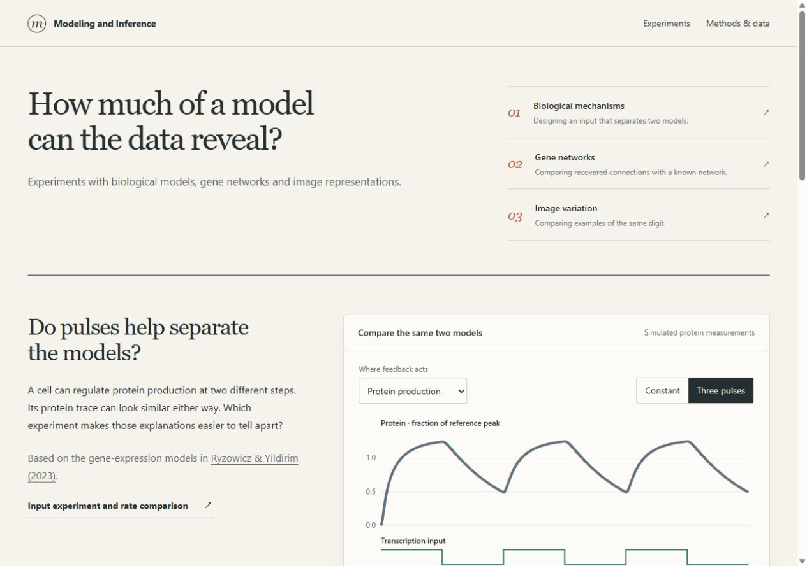

# Modeling and Inference

Experiments with biological models, gene networks and image representations.

**[Explore the experiments →](https://lacrimaeaware.github.io/modeling-and-inference/)** · [Methods and data](https://lacrimaeaware.github.io/modeling-and-inference/methods.html)

| Experiment | Question | Explore |
| --- | --- | --- |
| Biological mechanisms | Can changing the input make two feedback mechanisms easier to distinguish? | [Compare input signals](https://lacrimaeaware.github.io/modeling-and-inference/studies/hidden-rates.html) |
| Gene-network recovery | How does shared gene activity affect the connections inferred from it? | [Vary shared activity and noise](https://lacrimaeaware.github.io/modeling-and-inference/studies/gene-networks.html) |
| Image variation | What differences remain between images with the same digit label? | [Inspect digit examples](https://lacrimaeaware.github.io/modeling-and-inference/studies/image-representations.html#within-class) |

[Methods, data and references](https://lacrimaeaware.github.io/modeling-and-inference/methods.html) · [Data sources](PROVENANCE.md) · [Build locally](DEVELOPMENT.md)

LacrimaeAware
