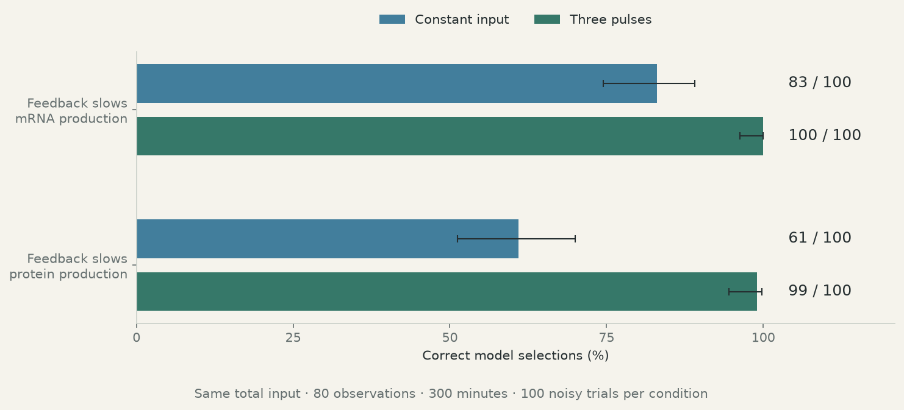

# Modeling and Inference

Independent research in experimental design, biological networks, and learned image representations.

**[Explore the visual portfolio →](https://lacrimaeaware.github.io/modeling-and-inference/)** · [Studies and methods](https://lacrimaeaware.github.io/modeling-and-inference/methods.html)

A model can fit observations while leaving its explanation uncertain. These studies ask what an experiment needs to distinguish competing mechanisms, recover network structure, or reveal a reusable rule inside an image encoder.

| Question | Result |
| --- | --- |
| **Which experiment separates two biological mechanisms?** | Three input pulses raise correct model selection from **61–83 to 99–100 out of 100 simulated trials**, depending on the mechanism, with the same duration, sample count, and total input. An accompanying scaling argument explains why the individual production rates still cannot be separated from protein alone. [Biological mechanisms →](https://lacrimaeaware.github.io/modeling-and-inference/studies/hidden-rates.html) |
| **When does removing shared gene activity help?** | A controlled simulation map separates shared activity from noise. At an illustrated setting, removing the leading component raises normalized recovery from **0.24 to 0.63**. Comparisons span five DREAM4 networks and eighteen BoolODE datasets; a further analysis examines how missing genes affect direct-edge interpretation. [Gene networks →](https://lacrimaeaware.github.io/modeling-and-inference/studies/gene-networks.html) |
| **Can variation within one class reveal structure shared with others?** | A recorded experiment finds color-related variation using shape labels, without color labels. Other tests examine handwritten digits and a trained image model. In the trained model, a fitted brightness rule transfers to **96 new image configurations and six multipliers**, tested across three independently trained models. [Geometry and transforms →](https://lacrimaeaware.github.io/modeling-and-inference/studies/image-representations.html) |

## Approach and context

The work combines ODE models and parameter fitting in **Python/SciPy**, network simulations and comparative benchmarks, and **PyTorch** image encoders evaluated on separate fitting and test configurations. The portfolio includes interactive figures, saved measurements, and scripts that regenerate its plots.

The biological models come from [Ryzowicz & Yildirim (2023)](https://doi.org/10.1039/D2MO00222A). The network study connects to [BEELINE](https://doi.org/10.1038/s41592-019-0690-6) and [modular response analysis](https://pmc.ncbi.nlm.nih.gov/articles/PMC130547/); the representation study connects to [learning from paired changes](https://proceedings.mlr.press/v119/locatello20a.html).

The pulse result is a simulation-based design comparison. Network benchmarks use known simulated structure, while the separate real-cell analysis examines response consistency. The image study examines attribute discovery and image changes; a separate control fits a predefined color rule. Each study gives its comparisons and scope alongside the result.

[Methods, data and references](https://lacrimaeaware.github.io/modeling-and-inference/methods.html) · [Data provenance](PROVENANCE.md) · [Build locally](DEVELOPMENT.md)

LacrimaeAware · Developed with AI assistance in implementation, analysis, and editing. Unrefereed work; external priority is unestablished.
